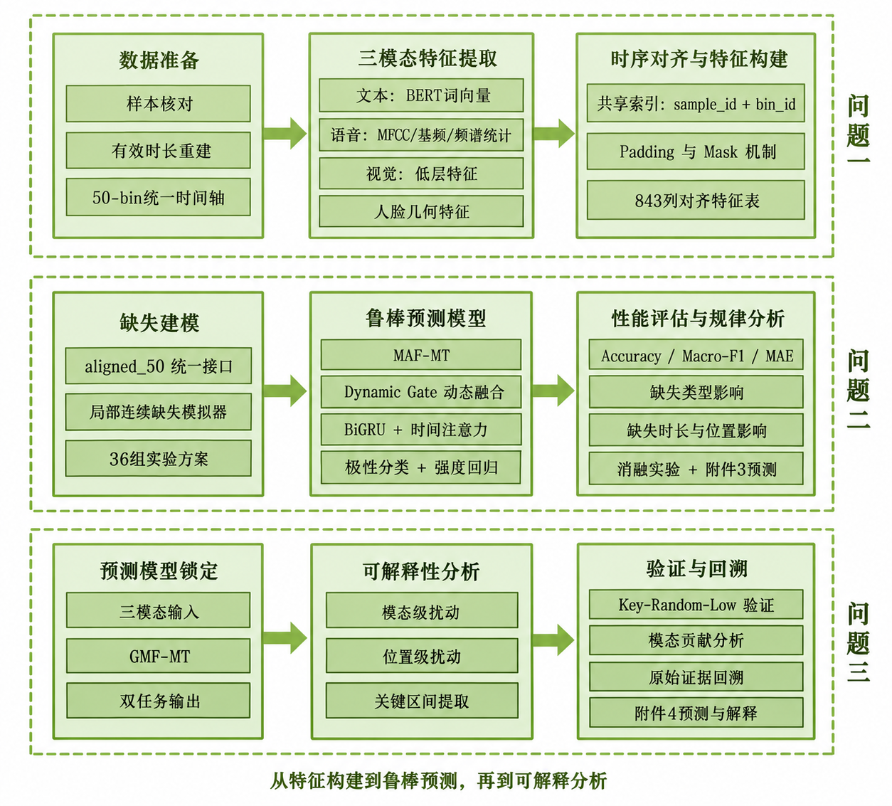

# Multimodal Emotion Modeling



围绕复杂场景下的多模态情感识别，项目展示三项已经完成并经过核验的工作：从原始视频构建统一时间轴特征；在局部模态缺失下训练和评估情感预测模型；对冻结模型的预测做模态贡献、关键位置和忠实性分析。

> **数据关系**：问题一处理附件 1 的 100 条原始视频。问题二、三使用官方附件 2 的 `aligned_50` 特征，分别对无标签附件 3、4 推理。问题一生成的 50-bin 表没有作为问题二、三的训练输入。

## 方法与结果

| 部分 | 核心方法 | 已核验结果 |
|---|---|---|
| [问题一](docs/q1_method.md) | 官方转写文本经 BERT 编码；ASR 仅提供词时间参考；声学、视觉与人脸特征汇入 50-bin 时间轴 | 100 条样本 × 50 bin，最终表 843 列；官方文本覆盖 4414/5000 bin |
| [问题二](docs/q2_method.md) | 连续局部缺失模拟、动态门控融合、BiGRU 与时间注意力、极性分类与强度回归 | 727 条独立 test：主模型 Macro-F1 **0.6303**、MAE **0.6201**；传统基线为 0.5689、0.7628 |
| [问题三](docs/q3_method.md) | 三模态门控融合双任务预测；模态和位置扰动；Key–Random–Low 忠实性比较 | 727 条独立 test：Macro-F1 **0.6244**、MAE **0.6767**；附件 4 的 20 条样本完成预测与解释 |

问题二、三的独立 test 指标来自各自冻结模型，只分别描述各自的实验；不能把两组数字当作同协议模型排名。附件 3、4 没有真实标签，仓库不报告其预测准确率。

完整流程见 [流程图](docs/pipeline.md)。仓库提交的匿名汇总见 [`results/`](results/README.md)，包括问题一的[特征构建统计](results/public_summary.json)、问题二的 [test 指标](results/q2/test/outputs/q2_final_test_metrics.csv)与[36 组缺失条件曲线](results/q2/model/figures/main_vs_baseline_missing_rate_curves.png)，以及问题三的 [test 指标](results/q3/model/outputs/q3_final_metrics.json)与[解释忠实性汇总](results/q3/faithfulness/outputs/q3_faithfulness_summary.json)。

## 目录

```text
configs/            冻结实验设置与输入位置
src/data/           数据审计、缺失模拟和历史路径解析
src/features/       问题一的媒体、人脸和官方文本特征
src/models/         问题二、三模型及问题二推理
src/training/       缺失因素分析、消融和独立测试
src/explainability/ 问题三贡献、局部解释、忠实性和证据回看
scripts/            问题一至三的主要运行入口
docs/               流程、数据和方法说明
results/            匿名汇总、冻结模型、精选指标和图
data/               用户自行放入的官方数据和外部权重；大文件不纳入仓库
runs/               重新运行的输出；不纳入仓库
```

## 运行

实测环境为 Python 3.10.11。先安装 [`requirements.txt`](requirements.txt)，再按 [数据说明](data/README.md)放置官方数据和模型文件。以下命令均在本目录执行：

```powershell
python -m venv .venv
.\.venv\Scripts\python.exe -m pip install -r requirements.txt
.\.venv\Scripts\python.exe scripts\verify_release.py
.\.venv\Scripts\python.exe scripts\run_q1.py
.\.venv\Scripts\python.exe scripts\train_q2.py
.\.venv\Scripts\python.exe scripts\predict_q2.py
.\.venv\Scripts\python.exe scripts\train_q3.py
.\.venv\Scripts\python.exe scripts\explain_q3.py
```

运行入口在缺少官方数据或外部权重时会指出缺失路径。`run_q1.py` 重建最终**官方转写文本**版本，要求已有媒体及人脸增强基表；[方法说明](docs/q1_method.md)列出基表来源。问题二最终推理包括经附件 2 `valid` 选定的文本缺失表示与中性 logit 校正。问题三 `explain_q3.py` 使用冻结模型及已核验的 test 解释汇总，对附件 4 同时生成预测和解释。各入口把新输出写入 `runs/`，保留 `results/` 中的冻结证据。

`verify_release.py` 只检查已附的匿名汇总、精选结果和两个轻量模型，无需官方原始数据。其余入口需要对应数据及部分未发布的逐样本审计文件；完整训练可能耗时较长。

## 证据边界

- 问题一使用 `label-100.xlsx` 的**官方转写文字**作为 BERT 语义输入；情感标签只作为保留字段，没有输入 BERT。26 条样本的官方词时间采用比例回退，其 bin 覆盖属于估计值，不能视为准确的词级时间对齐。
- 问题二附件 2 的 `train/valid/test` 为 3395/728/727；test 在模型锁定后评估，附件 3 只用于最终无标签推理。原始全零特征行与人工缺失 mask 分开处理。
- 问题三的关键位置说明模型决策敏感性，不等于因果解释。附件 4 的文本片段可回到原文；音视频时间与帧为带质量标记的回看参考，不能称为已核实的特征提取时刻。

代码保留了实验中使用的计算方法；从比赛工作区迁移到本目录时，文件组织和输入路径已调整，冻结结果文件未重新训练或改写。Git 提交仅纳入匿名汇总、指标、图和必要模型；官方转写、样本编号、逐样本预测及完整特征表留在本地且被忽略。大规模训练和原始媒体处理需要官方数据及本地模型权重。
